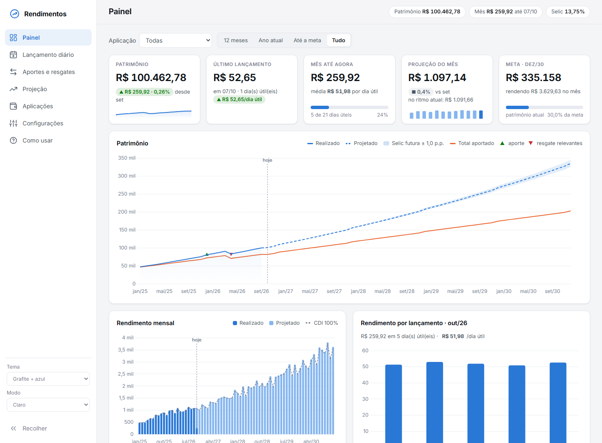
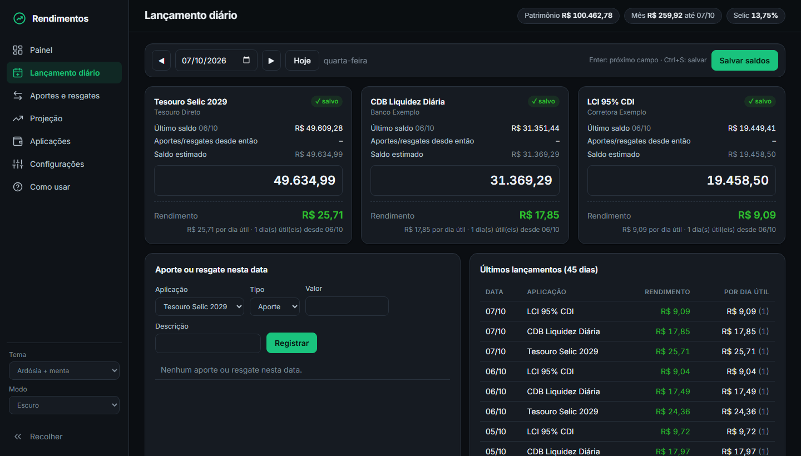
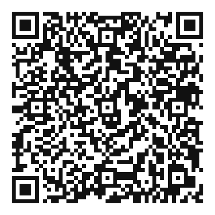

# Rendimentos

Controle pessoal de investimentos de renda fixa que roda no seu computador: você lança o **saldo do dia** de cada aplicação e o sistema calcula o rendimento, consolida mês a mês e projeta o patrimônio até a data que você definir, com base na Selic.

> Tudo funciona offline, sem cadastro e sem nuvem. Os dados ficam em um único arquivo SQLite no seu computador.



## Funcionalidades

- **Lançamento diário por saldo**: você informa o valor que aparece no app do banco e o rendimento é calculado sozinho, descontando aportes e resgates. Avisa quando o valor parece fora do padrão.
- **Painel**:
  - indicadores do mês, último lançamento e progresso da meta;
  - gráfico de patrimônio realizado × projetado, com faixa de cenários da Selic;
  - rendimento mensal comparado ao CDI;
  - consolidado por ano.
- **Vários tipos de aplicação**: % do CDI, Tesouro Selic, prefixado, IPCA+ e taxa mensal fixa.
- **Selic variável**: busca o histórico oficial no Banco Central (SGS) e monta cenários futuros a partir do boletim Focus. Também aceita vigências manuais.
- **Aportes planejados**: valores mensais por período, com opção de escolher meses específicos (ex.: 13º em novembro e dezembro).
- **Cálculo por dia útil** (base 252), com calendário de feriados nacionais já cadastrado.
- **3 temas** (Grafite, Noir e Ardósia), com modo claro e escuro.
- **Tutorial embutido** na aba *Como usar*.



## Requisitos

- Python 3.10 ou superior. Não precisa instalar nenhuma biblioteca: o servidor usa só a biblioteca padrão.
- Um navegador atualizado.

## Como executar

```bash
git clone https://github.com/Dinarte-Moscon/rendimentos.git
cd rendimentos
python app.py
```

No Windows, basta dar dois cliques em `iniciar.bat`. No Linux e no macOS, use `python3 app.py`.

O navegador abre em `http://localhost:8765`. Para usar outra porta: `python app.py --porta 9000`.
Para encerrar, use `Ctrl+C` no terminal.

Na primeira execução o sistema cria o banco de dados, cadastra os feriados e busca a Selic atual no Banco Central.

## Primeiros passos

1. **Aplicações**: cadastre cada investimento e como ele rende.
2. **Lançamento diário**: informe o saldo atual de cada aplicação.
3. A partir daí, lance o saldo sempre que consultar o app do banco e registre aportes e resgates em *Aportes e resgates*.
4. (Opcional) Em **Projeção**, cadastre aportes planejados e o cenário da Selic. Em **Configurações**, ajuste a data da meta.

O guia completo está na aba **Como usar**, dentro do próprio sistema.

## Como o rendimento é calculado

| Situação | Regra |
|---|---|
| Entre dois lançamentos | `saldo atual − saldo anterior − aportes/resgates do período` |
| Mês fechado | `saldo final − saldo final do mês anterior − aportes do mês` |
| Mês atual | realizado até o último saldo + restante do mês projetado |
| Meses futuros | `(saldo anterior + aporte planejado) × fator do mês` |

O fator é calculado dia útil a dia útil, com a Selic vigente em cada dia:

- **% do CDI / Tesouro Selic**: `((1 + CDI)^(1/252) − 1) × percentual`, com CDI = meta Selic − 0,10 p.p. (ajustável)
- **Prefixado**: `(1 + taxa)^(1/252)`
- **IPCA+**: `((1 + IPCA projetado) × (1 + taxa))^(1/252)`

Os valores são **brutos**, ou seja, antes do imposto de renda.

## Dados e privacidade

- Os dados ficam em `dados/rendimentos.db`. A pasta `dados/` está no `.gitignore`.
- **Backup**: copie esse arquivo com o sistema fechado.
- **Outro arquivo de dados**: para usar outro banco, defina a variável de ambiente `RENDIMENTOS_DB` com o caminho do arquivo.
- **Conexões externas**: o sistema só acessa a internet para buscar a Selic e o Focus, usando as APIs públicas do Banco Central.

## Estrutura

| Arquivo | Conteúdo |
|---|---|
| `app.py` | Servidor HTTP local e API JSON |
| `calc.py` | Consolidado mensal, projeção e rendimento diário |
| `bcb.py` | Consulta da Selic (SGS 432) e do boletim Focus |
| `db.py` | Esquema SQLite, feriados e configurações |
| `static/` | Interface (HTML, CSS e JavaScript) |
| `docs/` | Imagens deste README (dados fictícios) |

## Créditos

- [Chart.js](https://www.chartjs.org/): MIT
- Fontes [Inter](https://rsms.me/inter/) e [JetBrains Mono](https://www.jetbrains.com/lp/mono/): SIL Open Font License
- Dados da Selic e do Focus: [Banco Central do Brasil](https://dadosabertos.bcb.gov.br/)

## Aviso

Ferramenta de controle pessoal. As projeções são estimativas e não são recomendação de investimento.

## Licença

Distribuído sob a licença [MIT](LICENSE), uma licença de código aberto curta e permissiva. Na prática:

- **Você pode** usar, copiar, modificar, distribuir e até vender, inclusive em projetos fechados ou comerciais.
- **Você deve** manter o aviso de copyright e o texto da licença nas cópias do código.
- **Sem garantia**: o software é fornecido "como está", e o autor não responde por problemas decorrentes do uso.

## Apoie o projeto

Se o Rendimentos for útil para você, considere apoiar com qualquer valor via PIX:



*Leia o QR code pelo app do seu banco (Pix → Pagar com QR code), não pela câmera do celular.*

**Chave PIX (aleatória):** `e0a8aecf-db74-4ffa-b76c-640526c9149b`

**PIX copia e cola:**

```
00020126580014br.gov.bcb.pix0136e0a8aecf-db74-4ffa-b76c-640526c9149b5204000053039865802BR5914DINARTE MOSCON6010SANTA ROSA62070503***6304BD2D
```

Sugestões, relatos de erro e melhorias também são bem-vindos nas [issues](../../issues).
